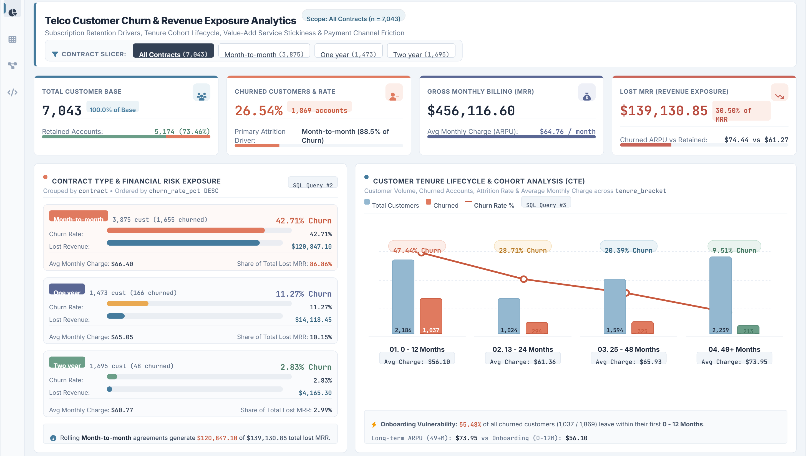
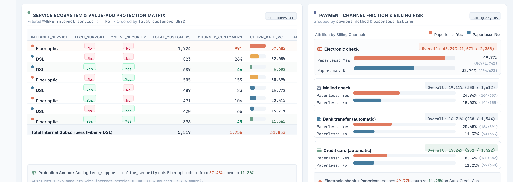
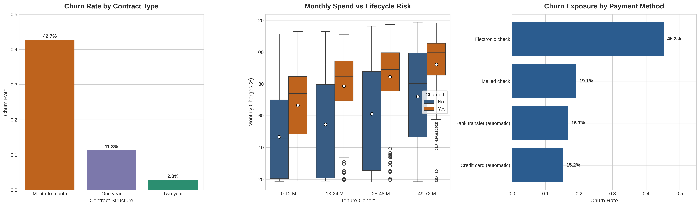

# Telco Customer Churn & Revenue Exposure Analytics

An end-to-end analytics project evaluating subscription retention drivers, customer lifetime risk, and recurring revenue exposure across 7,043 customer accounts. Built with a cloud-native data stack leveraging **Neon (PostgreSQL)** for staging/analytical modeling, **Python** for automated ingestion and statistical EDA, and an interactive **Executive BI Dashboard** for KPI reporting.

---

## Executive BI Dashboard Overview





---

## Business Problem & Objectives

Customer attrition poses a direct threat to Monthly Recurring Revenue (MRR) in subscription-based services. This project quantifies customer lifecycle friction and segments high-risk cohorts to support targeted retention strategies.

**Core Objectives:**
* Quantify baseline churn rate and aggregate MRR exposure.
* Identify high-risk segments across contract models, onboarding lifecycles, and payment workflows.
* Provide data-driven strategic interventions to mitigate revenue leakage.

---

## Technical Stack & Architecture

* **Database Engine:** PostgreSQL (Serverless instance deployed on Neon)
* **Analysis & Transformation:** Python 3.10+ (`pandas`, `numpy`, `SQLAlchemy`, `psycopg2`)
* **Data Visualization & BI:** Executive BI Dashboard, `matplotlib`, `seaborn`
* **Development Environment:** VS Code, Google Colab

```text
customer-churn-analytics/
├── notebooks/
│   └── exploratory_data_analysis.ipynb         # End-to-end data pipeline & visual EDA
├── sql/
│   ├── 01_schema_setup.sql                     # Raw staging DDL
│   └── 02_analytical_queries.sql               # Business marts, aggregations, & cohorts
├── powerbi_churn_executive_dashboard1.png      # Executive KPIs & Cohort BI View
├── powerbi_churn_executive_dashboard2.png      # Service Matrix & Payment BI View
├── churn_analysis_dashboard.png                # Python statistical EDA output
├── .gitignore
├── README.md
└── requirements.txt
```

---

## Key Business Insights & Python Statistical EDA



### 1. Executive Summary & Revenue Exposure
* **Overall Attrition:** The aggregate customer churn rate stands at **26.54%** (1,869 / 7,043 customers).
* **Financial Impact:** Churned accounts account for **$139,130.85** in lost Monthly Recurring Revenue, representing **30.50%** of gross monthly billings ($456,116.60).

### 2. Contract Structure & Commitment Risk
* **Month-to-Month:** Customers on rolling monthly agreements experience an acute attrition rate of **42.71%** ($120,847.10 lost MRR), representing **86.86%** of all lost monthly revenue.
* **Long-Term Commitments:** One-year contracts decline to **11.27%** churn, while two-year contracts bottom out at **2.83%**.

### 3. Lifecycle Velocity & Onboarding Drop-off
* **Early Lifecycle Vulnerability:** The first 12 months exhibit a churn rate of **47.44%** (1,037 / 2,186 customers). Over **55%** of all customer departures occur within the first year, confirming onboarding and early product adoption as the primary operational risk zone.

### 4. Service Ecosystem & Feature Stickiness
* **Fiber Optic Exposure:** Fiber optic users without `tech_support` or `online_security` churn at **57.48%** (991 / 1,724 accounts).
* **Protection Anchor:** Bundling both `tech_support` and `online_security` reduces Fiber optic churn down to **11.36%** and DSL churn to **6.68%**.

### 5. Billing Friction & Channel Dynamics
* **Electronic Check:** Customers utilizing electronic check payments exhibit a **45.29%** overall churn rate (reaching **49.77%** when combined with paperless billing), compared to **15.24%–16.71%** across automated credit card and bank transfer channels.

---

## Strategic Recommendations

| Initiative | Target Segment | Strategic Action |
| :--- | :--- | :--- |
| **Contract Migration Campaign** | Month-to-Month Cohort | Provide 10–15% annual discounts to lock high-risk users into 1-year agreements. |
| **High-Touch Onboarding** | Tenure 0–12 Months | Trigger automated check-ins and customer success interventions within the first 90 days. |
| **Auto-Pay Migration Incentive** | Electronic Check Users | Offer one-time billing credits to incentivize conversion to credit card/bank direct debit. |
| **Support Bundling** | Fiber Optic Subscribers | Bundle Tech Support and Online Security into core Fiber plans to reduce the 57.48% attrition spike. |

---

## Reproducibility & Pipeline Setup

### 1. Database Initialization
Execute the staging DDL in `sql/01_schema_setup.sql` on your PostgreSQL instance:
```bash
psql -d "<NEON_CONNECTION_STRING>" -f sql/01_schema_setup.sql
```

### 2. Ingestion & Analysis
Install required dependencies and execute the EDA notebook:
```bash
pip install -r requirements.txt
jupyter notebook notebooks/exploratory_data_analysis.ipynb
```

### 3. Business Mart Queries
Run `sql/02_analytical_queries.sql` directly within your SQL editor to reproduce all aggregate financial metrics and cohort tables.
